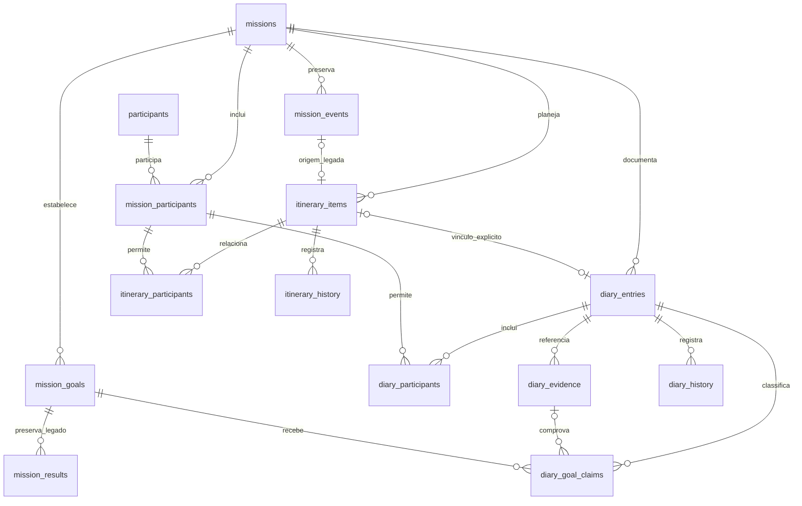

# Arquitetura do SECCO Global PE, etapa 3

> **Distribuição pública:** participantes, e-mails, domínio Workspace, IDs de Drive/pastas e projeto Cloud são fictícios. Documentos de validação preservam registros do desenvolvimento operacional; seus números não são resultados desta cópia pública. A validação da distribuição está em `docs/distribuicao-publica.md`.

> **Distribuição pública:** nomes, e-mails, domínio Google Workspace, IDs de Drive/pastas e identificadores Google Cloud deste documento são fictícios. Resultados e decisões descritos referem-se ao projeto operacional.

FastAPI renderiza HTML com Jinja2. O JavaScript oferece melhoria progressiva, sem substituir formulários e navegação nativos. SQLite continua como fonte principal da verdade.

O fluxo é: rotas → serviços → repositórios → SQLite. Os modelos de missão existentes foram preservados. O módulo services/itinerary.py concentra validação, conversão de horários e apresentação da agenda; operational_dashboard em services/missions.py compõe a visão Hoje. Os repositórios encapsulam SQL parametrizado e transações.

## Evolução aditiva

A migração 001_foundation.sql permanece byte a byte igual à primeira etapa. A migração 002_itinerary.sql:

- Cria itinerary_items para atividades planejadas, inclusive sem data ou horário.
- Cria itinerary_participants, reutilizando participants e mission_participants.
- Cria itinerary_history para snapshots operacionais de criação, edição e cancelamento.
- Corrige Renato para Alan Renato no mesmo ID, preservando e-mail e vínculos, quando não há outro participante com o nome novo.
- Não apaga ou recria o banco, não altera as metas e não remove registros anteriores.

A tabela mission_events da fundação exige início UTC e não comporta oportunidades sem data. Ela é preservada como origem legada. Registros legados são importados uma vez, com legacy_event_id único, convertendo o instante para data e horário locais. A origem permanece intacta; a visão operacional usa somente a representação vinculada em itinerary_items. Novos cadastros escrevem apenas nessa tabela. Uma importação não presume confirmação.

O helper dashboard_data mantém o contrato de leitura legado para compatibilidade. A página atual usa operational_dashboard e a agenda nova, sem contar o registro legado duas vezes. Não há novas tabelas de missão, usuário ou participante.

## Relações

As chaves compostas impedem associar uma pessoa de outra missão à atividade. As consultas, detalhes, edições e cancelamentos sempre filtram pelo ID da missão e da atividade. Não há exclusão física pela interface.

## Gravação e concorrência

A criação aceita uma request_key única. Repetir o mesmo envio retorna o registro existente. Reutilizar a chave com dados diferentes ou para outra missão gera conflito, sem descartar o texto digitado silenciosamente.

A edição compara version em transação BEGIN IMMEDIATE. Uma aba desatualizada recebe conflito 409 e conserva seus campos. Não há sobrescrita automática. O usuário pode abrir o registro atual em outra aba para comparar.

O cancelamento mantém o item com status cancelado e registra snapshot. Uma edição posterior permite rever a situação explicitamente. O histórico atual não tem autoria autenticada e não deve ser apresentado como auditoria financeira ou legal completa.

## Dados e proveniência

A inicialização inclui 20 itens conhecidos:

- Argentina: dois dias do simpósio, 18 e 19/11, sem horários ou inscrição presumida.
- Argentina: três oportunidades institucionais sem datas.
- Argentina: dez sugestões turísticas sem reservas ou datas.
- Portugal: cinco atividades previstas sem datas, horários ou endereços presumidos.

Não há compromissos confirmados na carga. A origem fica nula quando o documento não foi fornecido, com indicação de validação pendente. Turismo usa Sugestão dos viajantes. O endereço do Palacio Paz foi fornecido expressamente pela equipe e habilita o link de mapa; não é resultado de geocodificação nem comprova participação.

O seed_key único impede duplicação e preserva edições e cancelamentos na carga seguinte. A carga inicial não é um mecanismo de atualização de conteúdo já alterado pelo usuário.

## Datas e status

Datas e horários de planejamento são locais ao fuso da missão. Ao definir horário, o serviço grava também o instante UTC, calculado por ZoneInfo. Horários inexistentes ou ambíguos em transições de fuso são recusados com explicação. Não são inventados offsets.

O término deve ocorrer depois do início no mesmo dia. Atividades que atravessam a meia-noite devem ser divididas nesta etapa. Uma atividade sem data não aceita horário. Confirmado e Realizado exigem data, mas horários continuam opcionais.

Hoje é calculado no fuso da missão, independentemente do navegador. Próximo compromisso considera somente Confirmado, incluindo itens em curso com término futuro. Atividades realizadas, canceladas e sugestões não ocupam esse destaque. Sem horário, a informação é apresentada explicitamente.

A agenda mostra o período oficial e permite consultar outras datas. A consulta de datas fora do período oficial é uma funcionalidade da agenda; exemplos públicos não representam extensão de viagem de participantes. O dia atual é destacado quando estiver na faixa.

Marcar uma atividade como Realizado não soma automaticamente uma reunião qualificada ou LOI. Os critérios de metas e evidências continuam separados.

## Missão padrão e navegação

O cookie secco_mission guarda somente portugal ou argentina, por um ano, neste navegador local. É HttpOnly e SameSite=Lax. Ele é uma preferência, sem autenticação, identidade ou autorização.

A raiz redireciona à visão Hoje da última missão. Sem preferência válida, mostra a seleção. /?selecionar=1 permite escolher novamente. O cabeçalho mantém a troca acessível. Não há armazenamento de dados da agenda em localStorage ou IndexedDB.

## Segurança das edições

APP_ENV=development e DEV_NO_AUTH=true continuam obrigatórios. O startup de produção é recusado e cada POST volta a validar a configuração. Clientes fora de loopback e hosts desconhecidos continuam bloqueados. A execução recomendada usa 127.0.0.1 e --no-proxy-headers.

Cada formulário possui token CSRF comparado com cookie HttpOnly SameSite=Strict. Origem e referência, quando presentes, devem corresponder ao servidor. A política Referrer-Policy=same-origin viabiliza o POST nativo sem JavaScript, sem enviar referências a sites externos. O CSP restringe scripts, estilos e recursos ao próprio servidor.

Os formulários aceitam somente URL encoded, com limite de tamanho e número de campos. O backend verifica categorias, status, origem, textos, datas, horários, participantes e links. URLs externas aceitam apenas HTTP(S), sem credenciais. Templates têm autoescape.

## UX e resiliência

Visão Hoje apresenta data local, missão, próximo compromisso e programação antes dos indicadores. Formulários mostram o essencial primeiro; os detalhes opcionais ficam em um disclosure. As interações têm alvos de toque e foco visível.

Salvar usa fetch quando disponível. Erros e falha de conexão preservam os campos e não simulam conclusão. Sem JavaScript, POST/Redirect/GET e erros renderizados mantêm o preenchimento. A troca de dia substitui apenas o painel da agenda, mantém o histórico do navegador e restaura o foco. Solicitações anteriores são abortadas para evitar respostas fora de ordem.

O banco local fica no servidor. Não há cache de dados, fila offline, upload ou sincronização. Fechar ou recarregar um formulário ainda não salvo pode perder o preenchimento.

## QA da fundação

scripts.serve_qa cria um banco temporário, com o mesmo startup e seeds. Somente esse servidor registra /**qa**/identity e /**qa**/shutdown. O teste de navegador exige a identificação de isolamento antes de gravar. O encerramento de QA exige o mesmo CSRF e permite apagar somente o diretório temporário de teste, controlado pelo helper.

O servidor normal não possui essas rotas de QA. Os testes pytest usam bancos temporários por fixture. Os artefatos visuais e ferramentas ficam ignorados pelo Git.

## Próximas extensões

Autenticação real e autorização por missão precedem qualquer uso compartilhado. Documentos armazenados e regras financeiras ainda precisam de integração e checklists próprios. O fluxo de comprovantes está descrito em ux-registro-rapido.md e não possui botão ou upload simulado.

## Diário e resultados, etapa 3

A migração aditiva 003_diary.sql acrescenta organizacao à agenda e cria cinco tabelas: diary_entries, diary_participants, diary_evidence, diary_goal_claims e diary_history. As migrações 001 e 002 são preservadas com checksums fixos. Não há carga de resultados ou registros demonstrativos.

O módulo services/diary.py valida dados, tipos, status e classificação sem presumir critérios da proposta. repositories/diary.py encapsula transações, controle de versão, relações e snapshots. routers/diary.py compartilha renderização, CSRF e respostas progressivas HTML/JSON da arquitetura existente.

As FKs compostas garantem missão do registro, compromisso, participantes, evidências e metas. O vínculo com agenda é opcional e único. Participantes reutilizam mission_participants. Metadados de evidência pertencem obrigatoriamente ao registro e à missão; uma classificação não aceita evidência de outro registro, mesmo na mesma missão.

O Diário pode estar incompleto como Rascunho. Realizada exige dados mínimos de fato ocorrido. Realização da agenda, Diário e qualificação são decisões independentes. Não há incremento automático de contador.

eligible_goal_claims filtra status, justificativa, referência do critério, aprovação manual, comprovação e versões do registro e da evidência. MissionRepository agrega essa visão para os indicadores das duas missões. mission_results fica preservada como legado sem classificação, sem entrar nos indicadores finais. Não há escrita dupla ou migração presumindo comprovação de resultados antigos.

Edição de fatos e de evidências exige nova classificação. Aprovação registra a versão atual da evidência e do Diário; checagens na rota e na transação impedem aprovação baseada em referência alterada em outra aba. A visão também verifica as versões, mantendo a regra próxima da fonte da verdade.

Os totais do Diário e as atividades recentes ficam em seção secundária. A agenda do dia e o próximo compromisso continuam prioritários. Rascunhos e classificações pendentes são mostrados explicitamente, sem números demonstrativos.

O campo de horário do Diário representa o horário local da missão, sem exigir um instante UTC quando não há horário informado. created_at e updated_at são UTC. Os valores de exibição para rascunhos vazios não são gravados como título ou resultados reais.

A conferência e a aprovação são declarações manuais em desenvolvimento, sem identidade autenticada. Evidência é somente referência externa e metadados. Não há armazenamento, inspeção automática de documentos ou integração Shared Drive. As regras detalhadas estão em diario-e-metas.md.

## Isolamento de testes, etapa 3

app/core/test_database.py centraliza concessões temporárias, validação de caminhos, proteção de conexão e limpeza verificada. A política é ativada antes do carregamento de configuração no pytest e no helper de QA. Testes não herdam o banco do .env; DATABASE_PATH persistente explícito falha em vez de ser ignorado.

A mesma política protege migrate antes de mkdir e connect antes de SQLite. Guardas de processo impedem operações acidentais no diretório operacional. O navegador só prossegue após validar a identidade exata da concessão. O servidor operacional recusa requisições identificadas como QA. Consulte isolamento-testes.md para limites e operação.

A porta 8001 da etapa anterior é preservada. Templates usam um sinalizador de disponibilidade do Diário para manter compatibilidade com aquele processo já carregado. A etapa 3 pode rodar na porta 8002 com o mesmo banco atualizado de forma aditiva. Não há tentativa de encerrar o processo antigo da porta 8000.
